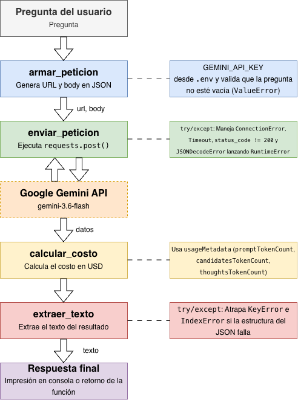

# Decisión de arquitectura: elección de modelo
  
## Modelo elegido

** Gemini 3.5-Flash-Lite**, para la funcionalidad principal de la miniaplicación.
  
## Diagrama de arquitectura

El flujo completo comienza con la pregunta del usuario, la cual ingresa a armar_peticion para validar que no esté vacía `(ValueError)`, cargar la credencial `GEMINI_API_KEY` desde `.env` y construir la URL junto con el body en formato JSON; posteriormente, `enviar_peticion` ejecuta la llamada HTTP con `requests.post()` hacia la Google Gemini API (gemini-3.6-flash), protegiendo la comunicación mediante un bloque `try/except` que ataja fallos de red (ConnectionError, Timeout, status_code != 200 y JSONDecodeError) para lanzar un RuntimeError si la petición falla. Una vez recibida la respuesta con los datos, se derivan a `calcular_costo`, función que procesa los tokens de `usageMetadata` (promptTokenCount, candidatesTokenCount y thoughtTokenCount) para determinar el costo exacto en USD, para luego pasar a `extraer_texto`, que aísla la respuesta textual protegiéndose de posibles fallos de estructura JSON (KeyError e IndexError con try/except), entregando así la respuesta final mediante su impresión en consola o el retorno de la función.
  
## Comparación de candidatos

## Comparación de candidatos

| Criterio | Gemini 3.6 Flash | Gemini 3.5 Flash-Lite | Gemini 3.1 Flash-Lite |
|---|---|---|---|
| Costo por 1000 tokens de entrada | 0,0008 USD | 0,0004 USD | 0,0003 USD |
| Costo por 1000 tokens de salida | 0,0038 USD | 0,0025 USD | 0,0015 USD |
| Latencia promedio observada | 10,45 segundos | 5,25 segundos | 12,49 segundos |
| Calidad de respuesta para el caso | Muy buena: Profundizó en causas técnicas avanzadas, explicando conceptos de geometalurgia, el impacto en la producción final y restricciones en etapas posteriores. | Muy buena: Mantuvo una respuesta impecable, ordenada y con razones técnicas mineras mucho más precisas en todos sus intentos. | Regular: Más inconsistente al cambiar la forma de presentar las ecuaciones en la mitad de las pruebas y ofrecer explicaciones operativas un poco más generales. |
| Fecha de medición | 2026-10-23 | 2026-10-23 |
  
## Justificación

Porque ofrece el mejor equilibrio entre calidad técnica, velocidad y costo operativo para este script: logró calcular con precisión exacta la desviación del -16,67%, mantuvo las fórmulas matemáticas limpias de manera uniforme y entregó explicaciones mineras de muy buen nivel técnico, todo esto respondiendo en la mitad del tiempo promedio (5,25 s) y a una fracción del costo del modelo 3.6, evitando además la alta latencia y los bloqueos por límite de cuota (error 429) que sufrió la versión más pesada.
  
## Alternativa descartada y por qué

Se descartaron las otras alternativas porque gemini-3.6-flash resulta inviable para un flujo automatizado, ya que aunque ofreció la mayor profundidad técnica, su latencia de 10,45 segundos (alcanzando picos de casi 25 s por bloqueos de cuota con error 429) y un costo 4 veces mayor no justifican el gasto; mientras que gemini-3.1-flash-lite se descartó por su falta de consistencia, presentando errores de formato de ecuaciones, explicaciones operativas muy generales y el peor tiempo de respuesta promedio (12,49 s).